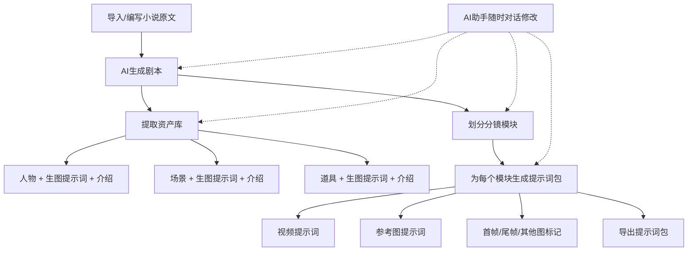
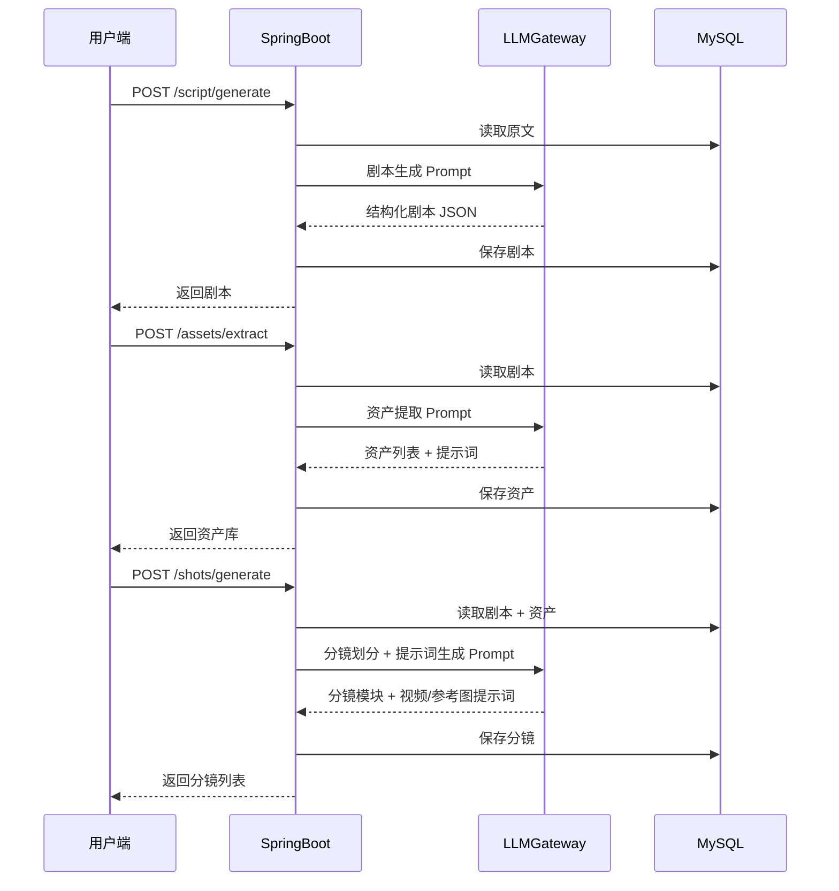

# StoryFlow 产品需求文档（PRD）

> 版本：v1.2 
> 日期：2026-10-04（v1.1：2026-09-29） 
> 技术栈：后端 Spring Boot · 前端 React · AI Qwen3.5-4B（Ollama 本地部署） 
> 说明：本文档基于产品定位编写，UI 参考图仅作交互方向参考，不照搬实现。 
> **实现状态与 API 以 [docs/](./README.md) 下专题文档为准。**

---

## 1. 项目概述

### 1.1 产品名称

**StoryFlow** —— AI 辅助剧本与提示词生产平台

### 1.2 产品定位

StoryFlow 是一个面向内容创作者、短剧/漫剧制作团队的 **提示词生产工具**。平台 **不生成图片、不生成视频**，而是将小说原文转化为结构化剧本，并自动提取资产、划分分镜模块，为每个模块产出可直接用于外部 AI 生图/生视频工具的 **提示词包**。

### 1.3 核心价值

| 痛点 | StoryFlow 解决方案 |
|------|-------------------|
| 小说改剧本耗时长 | AI 一键将原文转为标准剧本格式 |
| 人物/场景/道具散落各处 | 自动提取资产库，附带生图提示词与介绍文字 |
| 分镜划分靠人工 | 按剧本自动/半自动拆分为分镜模块 |
| 提示词编写门槛高 | 每个模块自动生成视频提示词、参考图提示词 |
| 修改迭代成本高 | 内置 AI 助手，随时对话修改任意内容 |

### 1.4 明确边界（Out of Scope）

- **不做**：图片生成、视频生成、配音合成、剪辑导出
- **只做**：文本结构化、提示词生成、资产管理、版本管理与导出

### 1.5 AI 模型选型

平台采用 **本地部署的 Qwen3.5-4B** 作为唯一 LLM，通过 **Ollama** 提供服务。

| 项目 | 说明 |
|------|------|
| 模型 | `qwen3.5:4b`（Ollama 本地） |
| 部署方式 | Ollama 本地服务，Spring Boot 经 HTTP 调用 |
| 上下文窗口 | 262K token（长章节原文无需硬切） |
| 显存需求 | Q4 量化约 5.5 GB；建议 8 GB 及以上独立显存或 Apple Silicon 16 GB 统一内存 |
| 选型理由 | 4B 在中文理解、结构化 JSON 输出、提示词生成质量上明显优于 0.8B，可满足比赛 MVP 与日常创作；完全离线，数据不出本地 |

**模型能力覆盖：**

| 任务 | 4B 预期 |
|------|---------|
| 小说 → 结构化剧本 | 良好（分段处理后） |
| 资产提取 + 生图提示词 | 良好 |
| 分镜划分 + 视频/参考图提示词 | 良好 |
| AI 助手对话修改 | 良好 |
| 稳定 JSON 输出 | 可用（需 Schema 校验 + 重试） |

**调用策略：** 所有 AI 任务采用 **分步流水线**（不一次性生成全部内容），每步输出经 JSON Schema 校验，失败自动重试（最多 3 次），仍失败则返回半成品供用户手动修改。

---

## 2. 用户角色

| 角色 | 说明 | 使用端 |
|------|------|--------|
| **普通用户** | 创作者，创建项目、编写/导入原文、生成剧本与提示词 | 用户端 |
| **管理员** | 运营/审核人员，管理用户、模板、模型配置、内容审核 | 管理端 |
| **超级管理员** | 系统配置、权限分配、全局 Prompt 模板管理 | 管理端 |

---

## 3. 核心业务流程



### 3.1 典型用户旅程

1. 用户创建项目，导入小说章节或粘贴原文
2. 点击「生成剧本」，AI 将原文转为结构化剧本（含时间、地点、人物、动作、台词、镜头）
3. 系统自动提取人物/场景/道具，生成各自的 **介绍文字** 与 **生图提示词**
4. 系统按剧本自动划分 **分镜模块**（每个模块对应一个镜头/段落）
5. 每个分镜模块生成：
 - 视频提示词
 - 一条或多条参考图提示词（用户可标记：首帧 / 尾帧 / 其他）
6. 用户通过 **AI 助手** 随时对话，要求修改剧本、资产、分镜或任意提示词
7. 导出完整提示词包（JSON / Markdown / Excel），供外部工具使用

---

## 4. 功能需求 — 用户端

### 4.1 账户与项目

| 功能 | 描述 | 优先级 |
|------|------|--------|
| 注册/登录 | **已实现**：邮箱 + 验证码注册，Session Token 鉴权（30 天）；无默认账号 | P0 ✅ |
| 项目管理 | 创建、重命名、删除、复制项目 | P0 |
| 项目列表 | 展示项目名称、分镜数、更新时间 | P0 |
| 项目设置 | 全局风格预设（如：日系动画、写实等） | P1 |

### 4.2 原文与剧本

| 功能 | 描述 | 优先级 |
|------|------|--------|
| 原文编辑 | 富文本/Markdown 编辑器，支持分章节 | P0 |
| 原文导入 | 支持 .txt / .docx / 粘贴导入 | P1 |
| 一键生成剧本 | AI 将原文转为标准剧本结构 | P0 |
| 剧本结构化展示 | 字段：时间、地点、人物、动作、台词、镜头 | P0 |
| 剧本手动编辑 | 用户可直接修改任意字段 | P0 |
| 版本历史 | 保存剧本每次 AI 生成/手动修改的快照，可回滚 | P1 |

**剧本单条记录结构：**

```
{
 "time": "日",
 "location": "学校门口",
 "characters": ["白崎玲", "黑川朔"],
 "action": "白崎玲撑开折叠伞，黑川朔从便利店跑出来",
 "dialogue": "白崎玲：「你怎么不带伞？」",
 "shot": "中景起，推至黑川朔特写"
}
```

### 4.3 资产库（元素库）

| 功能 | 描述 | 优先级 |
|------|------|--------|
| 自动提取 | 从剧本中识别并提取人物、场景、道具 | P0 |
| 资产卡片 | 每个资产包含：名称、类型、介绍文字、生图提示词 | P0 |
| 手动新增/编辑/删除 | 用户可补充或修改资产 | P0 |
| 重新生成提示词 | 对单个资产重新生成生图提示词 | P0 |
| 资产关联 | 显示该资产出现在哪些分镜模块中 | P1 |
| 资产合并/去重 | 识别同一人物不同称呼，支持手动合并 | P2 |

**资产数据结构：**

```
{
 "id": "asset_001",
 "type": "character | scene | prop",
 "name": "白崎玲",
 "description": "17岁女高中生，及肩黑发，穿校服，性格安静内敛",
 "imagePrompt": "17-year-old Japanese high school girl, shoulder-length black hair, school uniform, quiet expression, anime cel-shading style, clean line art, white background, character reference sheet",
 "appearances": ["shot_001", "shot_003"]
}
```

### 4.4 分镜模块

| 功能 | 描述 | 优先级 |
|------|------|--------|
| 自动划分 | AI 根据剧本自动拆分为分镜模块 | P0 |
| 手动调整 | 合并、拆分、拖拽排序分镜 | P0 |
| 模块信息 | 每个模块关联对应剧本段落 | P0 |
| 视频提示词 | 每个模块生成一条视频提示词 | P0 |
| 参考图提示词 | 每个模块可有多条，支持标记类型 | P0 |
| 参考图类型标记 | `首帧(first_frame)` / `尾帧(last_frame)` / `其他(other)` | P0 |
| 手动分配参考图角色 | 用户可将某条参考图提示词设为首帧或尾帧 | P0 |
| 重新生成 | 对单个模块的提示词重新生成 | P0 |
| 批量操作 | 批量重新生成、批量导出 | P1 |

**分镜模块数据结构：**

```
{
 "id": "shot_001",
 "order": 1,
 "scriptRef": "剧本段落 ID",
 "videoPrompt": "日漫赛璐璐，雨天学校门口中景，两名高中生，女孩撑伞，男孩从便利店方向跑来，镜头平滑推进，约4秒",
 "referencePrompts": [
 {
 "id": "ref_001",
 "type": "first_frame",
 "prompt": "日漫风格，雨天校门，女孩独自握着收起的伞，中景，16:9",
 "note": "首帧：玲独自等雨"
 },
 {
 "id": "ref_002",
 "type": "last_frame",
 "prompt": "日漫风格，学校门口，男孩拎着便利店袋子跑向女孩，雨天，中景，16:9",
 "note": "尾帧：朔跑来"
 },
 {
 "id": "ref_003",
 "type": "other",
 "prompt": "日漫特写，折叠伞撑开，水珠细节",
 "note": "参考：开伞细节"
 }
 ],
 "linkedAssets": ["asset_001", "asset_002", "asset_003"]
}
```

### 4.5 AI 助手（核心）

| 功能 | 描述 | 优先级 |
|------|------|--------|
| 全局对话面板 | 项目内随时唤起，侧边栏或浮窗 | P0 |
| 上下文感知 | 助手可读取当前项目：原文、剧本、资产、分镜、提示词 | P0 |
| 指令生成 | 用户说「把第3个分镜改成特写」→ 助手执行并更新 | P0 |
| 批量修改 | 「所有场景提示词改成赛博朋克风格」 | P1 |
| 对话历史 | 保存项目内对话记录 | P1 |
| 快捷指令 | 预设按钮：生成剧本 / 提取资产 / 划分分镜 / 生成全部提示词 | P0 |
| 局部选中修改 | 用户选中某段剧本或某条提示词，助手仅修改选中部分 | P1 |

**AI 助手能力范围：**

- 生成/修改：原文 → 剧本
- 生成/修改：资产提取与提示词
- 生成/修改：分镜划分
- 生成/修改：视频提示词、参考图提示词
- 分配/修改：参考图的首帧/尾帧/其他标记
- 回答创作建议（风格、镜头语言等）

### 4.6 导出

| 功能 | 描述 | 优先级 |
|------|------|--------|
| 导出提示词包 | 整项目导出为 JSON | P0 |
| 导出 Markdown | 可读性好的剧本文档 + 提示词 | P0 |
| 导出 Excel | 分镜表格式，方便团队协作 | P1 |
| 选择性导出 | 仅导出选中分镜或资产 | P2 |

### 4.7 用户端页面结构

```
用户端
├── 登录/注册
├── 项目列表页
├── 项目工作台（核心）
│ ├── 顶部：项目名称、全局风格、导出、AI助手入口
│ ├── 左栏：导航（原文 / 剧本 / 资产库 / 分镜）
│ ├── 主区域：根据导航切换内容
│ └── 右栏：AI 助手对话面板（可折叠）
└── 个人设置
```

---

## 5. 功能需求 — 管理端

### 5.1 仪表盘

| 功能 | 描述 | 优先级 |
|------|------|--------|
| 数据概览 | 用户数、项目数、今日 AI 调用量 | P0 |
| 趋势图表 | 7日/30日活跃趋势 | P1 |

### 5.2 用户管理

| 功能 | 描述 | 优先级 |
|------|------|--------|
| 用户列表 | 搜索、分页、查看详情 | P0 |
| 用户状态 | 启用/禁用账户 | P0 |
| 用量统计 | 每用户 AI 调用次数、项目数 | P1 |

### 5.3 Prompt 模板管理

| 功能 | 描述 | 优先级 |
|------|------|--------|
| 系统 Prompt 模板 | 管理剧本生成、资产提取、分镜划分、提示词生成等系统 Prompt | P0 |
| 模板版本 | 支持多版本，可切换生效版本 | P1 |
| 风格预设 | 管理全局风格选项（如：日系动画、写实、赛博朋克） | P1 |

### 5.4 AI 模型配置

| 功能 | 描述 | 优先级 |
|------|------|--------|
| Ollama 连接配置 | 配置 Ollama 服务地址（默认 `http://localhost:11434`）、模型名 `qwen3.5:4b` | P0 |
| 服务健康检测 | 检测 Ollama 是否在线、模型是否已拉取 | P0 |
| 推理参数 | 配置 temperature、top_p、max_tokens 等 | P1 |
| 调用限流 | 配置每用户/全局并发数与配额 | P1 |

### 5.5 内容管理（可选）

| 功能 | 描述 | 优先级 |
|------|------|--------|
| 公开项目审核 | 若未来支持分享，可审核公开项目 | P2 |
| 敏感词过滤 | 原文/剧本敏感内容检测 | P2 |

### 5.6 系统配置

| 功能 | 描述 | 优先级 |
|------|------|--------|
| 基础配置 | 站点名称、Logo、注册开关 | P1 |
| 操作日志 | 管理员操作审计 | P1 |

### 5.7 管理端页面结构

```
管理端
├── 登录
├── 仪表盘
├── 用户管理
├── Prompt 模板管理
├── AI 模型配置
├── 风格预设管理
└── 系统设置
```

---

## 6. 后端需求（Spring Boot）

### 6.1 技术选型

| 组件 | 选型 |
|------|------|
| 框架 | Spring Boot 3.x |
| 语言 | Java 17+ |
| ORM | MyBatis-Plus 或 Spring Data JPA |
| 数据库 | MySQL 8.0 |
| 缓存 | Redis |
| 鉴权 | Spring Security + **Session Token**（`auth_sessions` 表，Bearer / X-Auth-Token） |
| API 文档 | SpringDoc OpenAPI (Swagger) |
| 文件存储 | MinIO 或本地存储（导入文件） |
| AI 调用 | Ollama HTTP API + 统一 LLM Gateway 封装 |
| JSON 校验 | Jackson + JSON Schema 校验 LLM 输出 |
| 任务队列 | Redis Stream（长任务异步化、SSE 进度推送） |

### 6.2 模块划分

```
storyflow-backend/
├── storyflow-common/ # 公共工具、常量、异常
├── storyflow-api/ # 启动模块、Controller
├── storyflow-auth/ # 认证授权
├── storyflow-project/ # 项目 CRUD
├── storyflow-script/ # 原文、剧本
├── storyflow-asset/ # 资产库
├── storyflow-storyboard/ # 分镜模块
├── storyflow-prompt/ # 提示词生成与管理
├── storyflow-ai/ # AI 助手、LLM Gateway
├── storyflow-admin/ # 管理端接口
└── storyflow-export/ # 导出服务
```

### 6.3 核心 API 设计

#### 认证

| Method | Path | 描述 |
|--------|------|------|
| POST | `/api/auth/register/send-code` | 发送注册验证码 |
| POST | `/api/auth/register` | 邮箱验证码注册 |
| POST | `/api/auth/login` | 登录 |
| POST | `/api/auth/logout` | 登出 |
| GET | `/api/auth/me` | 当前用户 |

#### 项目

| Method | Path | 描述 |
|--------|------|------|
| GET | `/api/projects` | 项目列表 |
| POST | `/api/projects` | 创建项目 |
| GET | `/api/projects/{id}` | 项目详情 |
| PUT | `/api/projects/{id}` | 更新项目 |
| DELETE | `/api/projects/{id}` | 删除项目 |

#### 原文与剧本

| Method | Path | 描述 |
|--------|------|------|
| GET | `/api/projects/{id}/source` | 获取原文 |
| PUT | `/api/projects/{id}/source` | 更新原文 |
| POST | `/api/projects/{id}/script/generate` | AI 生成剧本 |
| GET | `/api/projects/{id}/script` | 获取剧本列表 |
| PUT | `/api/projects/{id}/script/{scriptId}` | 更新剧本条目 |
| GET | `/api/projects/{id}/script/versions` | 版本历史 |

#### 资产库

| Method | Path | 描述 |
|--------|------|------|
| POST | `/api/projects/{id}/assets/extract` | AI 提取资产 |
| GET | `/api/projects/{id}/assets` | 资产列表 |
| POST | `/api/projects/{id}/assets` | 手动新增资产 |
| PUT | `/api/projects/{id}/assets/{assetId}` | 更新资产 |
| DELETE | `/api/projects/{id}/assets/{assetId}` | 删除资产 |
| POST | `/api/projects/{id}/assets/{assetId}/regenerate-prompt` | 重新生成生图提示词 |

#### 分镜模块

| Method | Path | 描述 |
|--------|------|------|
| POST | `/api/projects/{id}/shots/generate` | AI 划分分镜 |
| GET | `/api/projects/{id}/shots` | 分镜列表 |
| PUT | `/api/projects/{id}/shots/{shotId}` | 更新分镜 |
| DELETE | `/api/projects/{id}/shots/{shotId}` | 删除分镜 |
| POST | `/api/projects/{id}/shots/reorder` | 排序 |
| POST | `/api/projects/{id}/shots/{shotId}/regenerate-prompts` | 重新生成该分镜全部提示词 |
| PUT | `/api/projects/{id}/shots/{shotId}/refs/{refId}` | 更新参考图提示词（含类型标记） |

#### AI 助手

| Method | Path | 描述 |
|--------|------|------|
| POST | `/api/projects/{id}/assistant/chat` | 发送消息（支持 SSE 流式） |
| GET | `/api/projects/{id}/assistant/history` | 对话历史 |
| POST | `/api/projects/{id}/assistant/actions` | 执行快捷指令 |

#### 导出

| Method | Path | 描述 |
|--------|------|------|
| POST | `/api/projects/{id}/export` | 导出（format: json/markdown/excel） |

#### 管理端

| Method | Path | 描述 |
|--------|------|------|
| GET | `/api/admin/dashboard` | 仪表盘数据 |
| GET/PUT | `/api/admin/users` | 用户管理 |
| GET/POST/PUT | `/api/admin/prompt-templates` | Prompt 模板 |
| GET/PUT | `/api/admin/ai-models` | Ollama 连接与推理参数配置 |
| GET | `/api/admin/ai-models/health` | 检测 Ollama 服务与模型可用性 |
| GET/PUT | `/api/admin/style-presets` | 风格预设 |

### 6.4 数据库核心表

```sql
-- 用户
users (id, email, password_hash, nickname, role, status, created_at)

-- 项目
projects (id, user_id, title, style_preset, settings_json, created_at, updated_at)

-- 原文
source_texts (id, project_id, content, updated_at)

-- 剧本
scripts (id, project_id, version, time, location, characters_json, action, dialogue, shot, order_index, created_at)

-- 剧本版本快照
script_versions (id, project_id, snapshot_json, created_at)

-- 资产
assets (id, project_id, type, name, description, image_prompt, created_at, updated_at)

-- 分镜
shots (id, project_id, script_id, order_index, video_prompt, created_at, updated_at)

-- 参考图提示词
reference_prompts (id, shot_id, type, prompt, note, order_index)

-- 分镜-资产关联
shot_assets (shot_id, asset_id)

-- AI 对话
assistant_messages (id, project_id, user_id, role, content, metadata_json, created_at)

-- Prompt 模板（管理端）
prompt_templates (id, name, category, content, version, is_active, created_at)

-- AI 模型配置
ai_model_configs (id, provider, model_name, base_url, config_json, is_active, updated_at)
-- provider 固定为 ollama，model_name 默认 qwen3.5:4b
```

### 6.5 AI 生成流水线

后端将 AI 任务封装为 **分步流水线**，每步独立调用 Qwen3.5-4B，避免单次 prompt 过长导致质量下降：

| 步骤 | 输入 | 输出 | 说明 |
|------|------|------|------|
| Step 1 | 原文（按 800~1500 字分段） | 剧本 JSON 数组 | 每段独立生成，后端合并 |
| Step 2 | 完整剧本 | 资产 JSON 数组 | 人物/场景/道具 + 介绍 + 生图提示词 |
| Step 3 | 剧本 + 资产上下文 | 分镜 JSON 数组 | 每条剧本对应 1~N 个分镜 |
| Step 4 | 单个分镜 + 关联资产 | 提示词 JSON | 视频提示词 + 参考图提示词（含首帧/尾帧/其他） |
| Step 5 | 用户消息 + 项目上下文 | 助手回复 + JSON Patch | AI 助手对话修改 |

**每步通用机制：**

- System Prompt 由管理端模板管理，含 few-shot 示例
- 要求模型 **仅输出 JSON**，关闭 thinking 模式以保证格式稳定
- 后端 JSON Schema 校验 → 失败重试（最多 3 次）→ 仍失败标记为「待人工修正」
- 长任务通过 Redis Stream 异步执行，前端 SSE 推送步骤进度

**Ollama 调用示例：**

```
POST http://localhost:11434/api/chat
{
 "model": "qwen3.5:4b",
 "stream": true,
 "format": "json",
 "options": { "temperature": 0.3, "num_predict": 4096 },
 "messages": [
 { "role": "system", "content": "..." },
 { "role": "user", "content": "..." }
 ]
}
```

后端将 AI 任务封装为可组合流水线：



**AI 助手对话流程：**

1. 接收用户消息 + 项目上下文（原文/剧本/资产/分镜摘要）
2. LLM 判断意图：问答 / 修改 / 生成
3. 若为修改/生成：LLM 输出结构化 JSON Patch
4. 后端校验并应用变更，持久化
5. 返回助手回复 + 变更摘要

---

## 7. 前端需求（React）

### 7.1 技术选型

| 组件 | 选型 |
|------|------|
| 框架 | React 18 + TypeScript |
| 构建 | Vite |
| 路由 | React Router v6 |
| 状态管理 | Zustand 或 Redux Toolkit |
| UI 组件 | Ant Design 或 shadcn/ui |
| 请求 | Axios + React Query |
| 富文本 | TipTap 或 Monaco Editor |
| 流式对话 | EventSource / fetch SSE |

### 7.2 项目结构

```
StoryFlow/
├── backend/ # Spring Boot API
├── frontend/ # 用户端 (5173)
│ └── src/
│ ├── pages/ # ProjectList, Workspace 等
│ ├── components/ # AssistantPanel 等
│ └── api/
├── admin/ # 管理端 (5174)
│ └── src/
│ ├── pages/ # Dashboard, PromptTemplates, AiModels 等
│ └── api/
└── docs/
```

### 7.3 关键 UI 组件

#### 分镜模块卡片（ShotCard）

每个分镜模块展示：

- 序号、关联剧本摘要
- 视频提示词（可编辑 textarea）
- 参考图提示词列表，每条带类型标签：
 - `首帧`（蓝色）
 - `尾帧`（绿色）
 - `其他`（灰色）
- 操作：重新生成、添加参考图、删除
- 关联资产标签（人物/场景/道具）

#### AI 助手面板（AssistantPanel）

- 对话消息列表（用户/助手）
- 输入框 + 发送
- 快捷指令按钮组
- 流式输出显示
- 变更提示：「已更新第 3 个分镜的视频提示词」

#### 资产卡片（AssetCard）

- 类型图标（人物/场景/道具）
- 名称、介绍文字
- 生图提示词（可编辑）
- 出现次数、关联分镜

### 7.4 交互要点

1. **参考图类型切换**：点击参考图提示词旁的标签，弹出选择首帧/尾帧/其他；同一分镜仅允许一条首帧、一条尾帧
2. **AI 助手上下文**：用户在某个分镜页对话时，助手默认聚焦该分镜；可切换为全局模式
3. **生成进度**：剧本/资产/分镜生成时显示 loading 与步骤提示
4. **乐观更新**：手动编辑提示词后立即保存，失败回滚

---

## 8. 非功能需求

| 类别 | 要求 |
|------|------|
| 性能 | 页面首屏 < 2s；AI 生成任务异步化，前端 SSE 推送进度；单章（3000 字）全流程生成 < 3 分钟 |
| 安全 | Session Token 鉴权、用户数据隔离、输入 XSS 防护；AI 推理完全本地，数据不出机；注册验证码经 SMTP 发送 |
| 可用性 | 核心流程 3 步内完成：导入原文 → 一键生成 → 导出 |
| 兼容性 | 用户端支持 Chrome/Edge/Safari 最新两个大版本 |
| 硬件 | 运行 Ollama 的机器需 8 GB+ 显存或 Apple Silicon 16 GB 统一内存 |
| 可扩展 | LLM Gateway 抽象层预留接口，后续可切换其他 Ollama 模型 |
| 数据 | 项目数据隔离，用户只能访问自己的项目 |

---

## 9. 里程碑规划

### Phase 1 — MVP（4 周）

- [x] 用户邮箱验证码注册登录、项目 CRUD
- [x] 原文编辑 + AI 生成剧本
- [x] AI 提取资产库（人物/场景/道具 + 生图提示词）
- [x] AI 划分分镜 + 生成视频/参考图提示词
- [x] 参考图首帧/尾帧/其他标记
- [x] AI 助手对话（生成 + 修改 + 删分镜 + 语言偏好）
- [x] JSON / Markdown 导出
- [x] 管理端：Prompt 模板 + Ollama 连接配置
- [x] Ollama + Qwen3.5-4B 本地部署与 LLM Gateway 对接

### Phase 2 — 增强（2 周）

- [x] 版本历史与回滚（项目快照）
- [x] Markdown 导出
- [x] 分镜拖拽排序、合并拆分
- [x] AI 助手勾选分镜、流式重生
- [x] 管理端仪表盘（基础）
- [ ] Excel 导出
- [x] 管理端用户管理

### Phase 3 — polish（2 周）

- [ ] 资产合并去重
- [x] 分镜批量重生
- [x] 风格预设系统
- [x] 操作日志与用量统计（AI 历史）

---

## 10. 术语表

| 术语 | 定义 |
|------|------|
| 原文 | 用户输入的小说文字 |
| 剧本 | 结构化的脚本条目（含时间/地点/人物/动作/台词/镜头） |
| 资产 | 从剧本中提取的人物、场景、道具 |
| 分镜模块 | 对应一个镜头/段落的提示词单元 |
| 视频提示词 | 供外部 AI 视频工具使用的文本提示 |
| 参考图提示词 | 供外部 AI 生图工具使用的文本提示 |
| 首帧/尾帧 | 视频片段的起始/结束画面参考图 |
| 提示词包 | 一个项目全部剧本、资产、分镜提示词的集合 |

---

## 11. 附录 A：文档与实现对照（2026-10-04）

| 主题 | 文档 |
|---|---|
| 文档索引 | [docs/README.md](./README.md) |
| 本地开发与 SMTP | [开发指南.md](./开发指南.md) |
| 架构与数据流 | [架构说明.md](./架构说明.md) |
| 邮箱注册登录 | [认证与注册.md](./认证与注册.md) |
| REST / SSE API | [API概览.md](./API概览.md) |
| 助手意图与中文提示词 | [AI助手能力说明.md](./AI助手能力说明.md) |
| 变更记录 | [CHANGELOG.md](./CHANGELOG.md) |

**与 PRD 差异说明：**
- 鉴权为 Session Token，非 JWT；无 refresh 接口
- 注册为邮箱验证码，非手机号
- 已移除本地默认账号
- 后端为单模块 Maven 工程，非 PRD §6.2 多子模块拆分（逻辑分包等价）

---

## 12. 附录 B：导出 JSON 示例

```json
{
 "project": {
 "title": "雨停之前",
 "style": "日系动画",
 "exportedAt": "2026-09-29T10:00:00Z"
 },
 "assets": [
 {
 "type": "character",
 "name": "白崎玲",
 "description": "17岁女高中生，及肩黑发，穿校服",
 "imagePrompt": "17-year-old Japanese high school girl..."
 }
 ],
 "shots": [
 {
 "order": 1,
 "script": {
 "time": "日",
 "location": "学校门口",
 "characters": ["白崎玲", "黑川朔"],
 "action": "白崎玲撑开折叠伞...",
 "dialogue": "白崎玲：「你怎么不带伞？」",
 "shot": "中景起，推至黑川朔特写"
 },
 "videoPrompt": "Medium shot, anime cel-shading...",
 "referencePrompts": [
 { "type": "first_frame", "prompt": "...", "note": "首帧" },
 { "type": "last_frame", "prompt": "...", "note": "尾帧" }
 ]
 }
 ]
}
```

---

*文档结束。如有调整需求，请反馈后迭代版本。*
